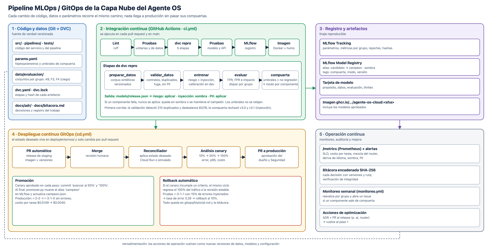

# Agente OS · Capa Nube · pipeline MLOps / GitOps (Fase III)

[](https://github.com/ColeMacGrath/agente-os-mlops/actions/workflows/ci.yml) [](https://github.com/ColeMacGrath/agente-os-mlops/actions/workflows/cd.yml)

Solución lista para producción de la Capa Nube del Agente OS: el gateway que recibe tareas ya enmascaradas desde la app de macOS, aplica tres barreras de seguridad (Filtro Ciego, validador de inyección y semáforo de riesgo), elige el modelo de Claude según la complejidad y registra cada decisión en una bitácora auditable.

Este repositorio continúa el proyecto: la **Fase I** definió el caso de negocio, la **Fase II** construyó el MVP, la **Actividad 9** rediseñó la arquitectura para 2,000 usuarios y auditó la equidad de las barreras, y la **Fase III** lo lleva a producción con integración continua, pruebas de código y datos, versionado de modelos y artefactos, despliegue continuo GitOps, monitoreo, auditoría y optimización.



## Resultados principales

| Indicador | Resultado | Evidencia |
|---|---|---|
| Pipeline reproducible | 5 etapas DVC; 60 pruebas; lint limpio; CI en GitHub Actions en ~4 min | `dvc.lock`, `docs/evidencias/capturas/terminal_*.png` |
| Iteraciones del modelo | v1 (Fase II) → v2 (Actividad 9) → v3.0 (rechazada) → v3.1 | `docs/evidencias/capturas/iteraciones_modelo.png` |
| Semáforo de riesgo v3.1 (ciego F4) | recall de riesgo alto 0.97, impacto dispar 0.83 | `reports/evaluacion.json` |
| Filtro Ciego v3 (ciego F4) | 100% de datos personales protegidos en seis países | `reports/evaluacion.json` |
| Inyección v3.1 (ciego F4) | detección 0.93 (campeón 0.53), FPR 0.17 → **en sombra** | `reports/compuerta.json`, ADR-0002 |
| Despliegue progresivo | r-2-0 → r-3-1-0 al 10/50/100%, costo por tarea $0.0149 → $0.0040 | `reports/canary_produccion.json` |
| Rollback automático | canary con 28% de errores revertido al 10% | `reports/canary_staging_rollback.json` |
| Análisis de canary estadístico | muestra pareada + Mann-Whitney: 0 rollbacks falsos en 5 corridas; detecta una canary 15% más lenta | ADR-0003 (revisión 2) |
| Operación (30 días simulados) | disponibilidad 100%, p95 ≤ 11.7 s, 23 alertas, 6 acciones | `operacion/salida/`, `docs/evidencias/capturas/tablero_*.png` |
| Optimización basada en datos | ajuste del router: costo por tarea −24% | ADR-0004 |
| Auditoría | 12,029 entradas íntegras; 0 acciones de riesgo alto sin Touch ID | `reports/auditoria.md` |

## Estructura

```
src/agente_os/        servicio: API, barreras, semáforo de riesgo, router, monitoreo y auditoría
pipelines/            etapas del pipeline (DVC) y registro/promoción en MLflow
data/evaluacion/      conjuntos de evaluación por grupo (A9 y F3 de desarrollo, F4 ciego)
data/contratos/       contratos de datos del pipeline
tests/                pruebas unitarias, de datos, de modelo y de API
deploy/               servicio de Cloud Run y estado deseado por entorno (GitOps)
gitops/               reconciliador, proxy de tráfico, análisis de canary e historial
operacion/            simulación de operación, alertas, tablero e informe de auditoría
docs/                 ADR, bitácora, arquitectura, evidencias y guía de GitHub
.github/workflows/    CI, CD GitOps y monitoreo semanal
```

## Uso local

```bash
python -m venv .venv && source .venv/bin/activate
pip install -r requirements-dev.txt

make lint pruebas          # ruff + pytest
make pipeline              # dvc repro: datos → validación → entrenamiento → evaluación → compuerta
make registrar             # registro en MLflow (mlflow ui --backend-store-uri sqlite:///mlflow.db)
make servir                # API en http://localhost:8000/docs (planificador simulado)
make canary ENV=produccion # despliegue progresivo con el reconciliador local
make operar auditoria      # 30 días de operación simulada e informe de auditoría
```

Para usar la API real de Claude: `PLANNER_MODE=claude ANTHROPIC_API_KEY=... make servir`.

## Qué es real y qué es simulado

El código del servicio, el pipeline, las pruebas, el registro de modelos, el reconciliador y el análisis de canary se ejecutan de verdad. Se simulan la latencia y el consumo de tokens de la API de Claude (sin llamadas facturables), el tráfico de usuarios y el entorno de Cloud Run cuando no hay credenciales de Google Cloud.

## Documentos de la entrega

Fuera de este repositorio se entregan el documento explicativo del pipeline, el documento técnico de operación, el portfolio técnico-estratégico y la simulación de entrevista. Todas sus cifras salen de `reports/` y `operacion/salida/`.

## Configurar GitHub

Ver [docs/configurar_github.md](docs/configurar_github.md).
